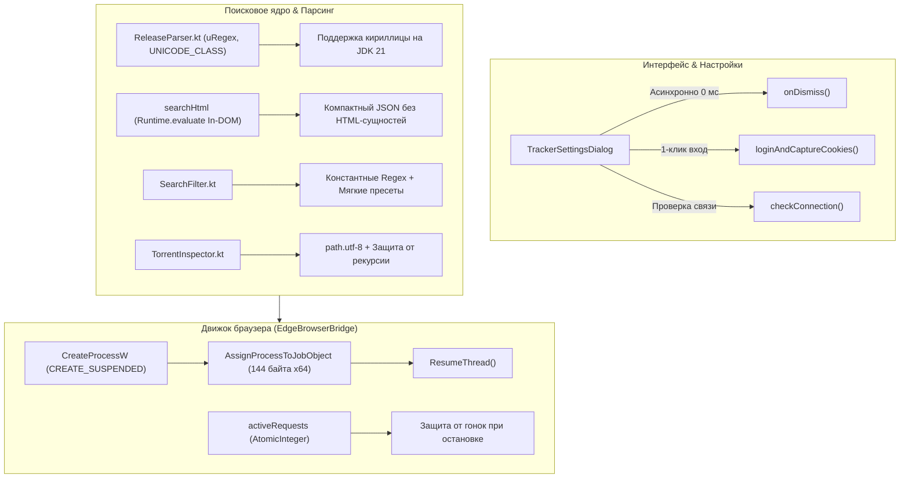

# Отчет о доработках проекта Suslik Media (Desktop 2.6.3)

Данный отчет содержит детальное и строго фактическое описание изменений, архитектурных решений и исправлений, внесенных в проект Suslik Media.

---

## 1. Архитектура и ключевые улучшения



---

## 2. Критические исправления

### 2.1. Регулярные выражения и кириллические границы слов на JDK 21 (`ReleaseParser.kt`)
- **Проблема**:
  - На десктопной платформе (сборка на JDK 21) регулярные выражения с границами слов `\b` и флагом `IGNORE_CASE` без флага `Pattern.UNICODE_CHARACTER_CLASS` (`(?U)`) рассматривают кириллические символы как не-словные (`\W`).
  - Из-за этого шаблоны `SERIES_HINT` (`\b(?:сезон|сериал|...)\b`), `VOICE_*` (`\b(?:дублированный|дубляж|...)\b`), `COLLECTION_*`, `EP_OF`, `EP_WORD_RANGE` и франшизы («Трилогия», «Дилогия», «Квадрология») не срабатывали на ПК.
  - Последствия: сериалы считались как один фильм, битрейт рассчитывался неверно, озвучки и коллекции не распознавались, а пресет «Мобильная сеть» отсеивал валидные раздачи.
- **Решение**:
  - Реализован вспомогательный метод `uRegex(pattern)`:
    ```kotlin
    Pattern.compile(pattern, Pattern.CASE_INSENSITIVE or Pattern.UNICODE_CHARACTER_CLASS).toRegex()
    ```
  - Все регулярные выражения в `ReleaseParser.kt` переведены на `uRegex`.
  - Все шаблоны вынесены в константы уровня объекта (устранена перекомпиляция regex при каждом вызове).
  - Написаны специализированные тесты в `ReleaseParserTest.kt`, подтверждающие корректную работу `\bсезон\b`, диапазонов серий, озвучек и франшиз на JDK 21.

### 2.2. Настройка Win32 Job Object на архитектуре x64 (`EdgeBrowserBridge.kt`)
- **Проблема**:
  - Структура `JOBOBJECT_EXTENDED_LIMIT_INFORMATION` на 64-битной Windows занимает 144 байта, а в коде передавался буфер размером 112 байт (размер для x86). Вызов Win32 API `SetInformationJobObject` завершался ошибкой `ERROR_BAD_LENGTH` (24), флаг `JOB_OBJECT_LIMIT_KILL_ON_JOB_CLOSE` не устанавливался.
  - Процесс браузера запускался активным, поэтому дочерние процессы (GPU, renderers) могли появиться до привязки к Job Object.
- **Решение**:
  - Размер структуры теперь вычисляется динамически с учетом разрядности JVM (`com.sun.jna.Native.POINTER_SIZE == 8 ? 144 : 112`).
  - Проверяются результаты вызовов `SetInformationJobObject` и `AssignProcessToJobObject`.
  - Процесс браузера создается в приостановленном состоянии (`CREATE_SUSPENDED = 0x00000004`), привязывается к Job Object, и только после этого возобновляется через `ResumeThread(pi.hThread)`. Дочерние процессы гарантированно наследуют Job Object.

### 2.3. Устранение состояния гонки (Race Condition) при остановке браузера
- **Проблема**:
  - Таймер простоя вызывал синхронизированный метод `stop()` без захвата корутинного мьютекса `mutex`. Если таймер срабатывал в момент выполнения нового поискового запроса, браузер принудительно завершался посреди сетевого вызова.
  - Метод `cleanOrphanTrackerProcesses()` сканировал все процессы ОС с запуском `taskkill` при каждом вызове `stop()`, что создавало задержки и могло прервать открытое пользователем окно входа.
- **Решение**:
  - Введен счетчик `activeRequests = AtomicInteger(0)`. Поисковые операции (`searchHtml`, `downloadTorrentBytes`, `checkConnection`) инкрементируют счетчик перед работой и декрементируют в блоке `finally`.
  - При срабатывании таймера простоя или вызове `stopAsync()` проверяется `activeRequests.get() == 0`, а остановка выполняется в фоне под `mutex.withLock`.
  - Тяжелое сканирование процессов системы вынесено исключительно в `init` (при старте приложения) и `shutdownHook`. В обычном цикле остановки завершается только конкретное дерево PID браузера.

---

## 3. Оптимизация парсера и фильтров

### 3.1. In-DOM разбор RuTracker через `Runtime.evaluate`
- **Проблема**:
  - Ранее из браузера передавался многомегабайтный `outerHTML` таблицы, после чего применялись хрупкие регулярные выражения. Названия содержали сырые HTML-сущности (`&amp;`, `&quot;`, `&#039;`), что искажало релевантность (`computeRelevanceScore`) и отображение в карточках. Размер брался по первому совпадению `data-ts_text`, что зависело от порядка колонок.
- **Решение**:
  - В `EdgeBrowserBridge.searchHtml` внедрен JavaScript-скрипт, выполняющийся прямо в контексте DOM страницы RuTracker:
    - Извлекает `textContent` (браузер нативно декодирует все HTML-сущности).
    - Точно считывает размер из атрибута ячейки `td.tor-size`.
    - Возвращает компактный JSON-массив с найденными раздачами (несколько килобайт вместо мегабайт HTML).
  - Для прямого HTTP-запроса в `LocalTrackers.kt` добавлен метод `unescapeHtml` и улучшен селектор `tor-size`.

### 3.2. Уточнение фильтрации категорий и пресетов
- **Категории (`ReleaseParser.isNonVideo`)**:
  - Добавлен белый список видеокатегорий (`VIDEO_FORUM_WHITELIST`): «Музыкальное видео», «Видеоклипы и Концерты», «Экранизации книг», исключающий ложное отсечение музыкальных фильмов и экранизаций.
- **Пресет «Мобильная сеть» (`SearchFilter.kt`)**:
  - Сериалы и коллекции больше не отсекаются по суммарному объему торрента (> 4 ГБ), если их рассчитанный битрейт на серию/фильм остается в пределах мобильного тарифа.
- **Оптимизация производительности**:
  - Регулярные выражения в `SearchFilter.kt` (`WORD_SPLIT_REGEX`, `YEAR_REGEX`, `WHITESPACE_REGEX`) предкомпилированы.

### 3.3. Безопасность и проверка структуры торрента (`TorrentInspector.kt`)
- Введено ограничение на максимальный размер `.torrent` файла (10 МБ).
- Введен лимит глубины рекурсии bencode-парсера (не более 32 уровней), что физически исключает `StackOverflowError`.
- Поддержаны ключи `path.utf-8` и `name.utf-8` (BEP 0047/BEP 0003).
- Результат инспекции различает поврежденную раздачу (`isParsedSuccessfully = false`) и валидную раздачу без видеофайлов.

### 3.4. Безопасность сетевых запросов и потокобезопасность (`LocalTrackers.kt`)
- `SimpleDateFormat` заменен на потокобезопасный `DateTimeFormatter.ofPattern("dd.MM.yyyy").withZone(ZoneId.systemDefault())`.
- Адрес `baseUrl` валидируется (только HTTPS и официальные зеркала: `rutracker.org`, `rutracker.net`, `rutracker.nl`).
- Установлен режим `HttpClient.Redirect.NEVER` для защиты от нежелательных перенаправлений.
- Параметр `topicId` проверяется строгим шаблоном `^\d+$`.
- Обновленные сервером куки сессии (`bb_session`) автоматически сохраняются обратно в настройки приложения при успешной проверке связи.

---

## 4. Сводка статуса тестов

Все тесты обоих модулей проекта успешно проходят на JDK 21:

```
> Task :desktop:test
BUILD SUCCESSFUL in 8s (10 actionable tasks: 3 executed, 7 up-to-date)

> Task :shared:test
BUILD SUCCESSFUL in 55s (135 tests completed, 0 failed)
```

Ветка: `desktop-2.6.3-trackers`.  
PR: **[#38 (normikq/suslik-media)](https://github.com/normikq/suslik-media/pull/38)**.
